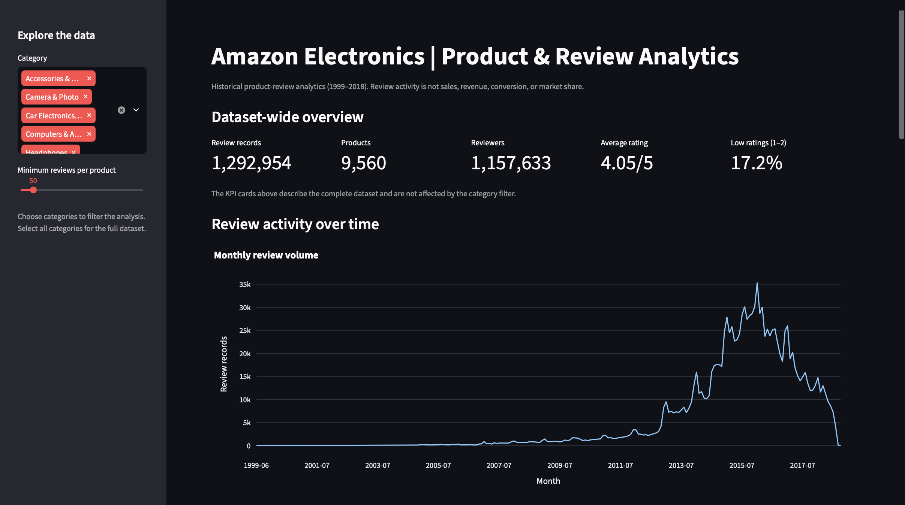
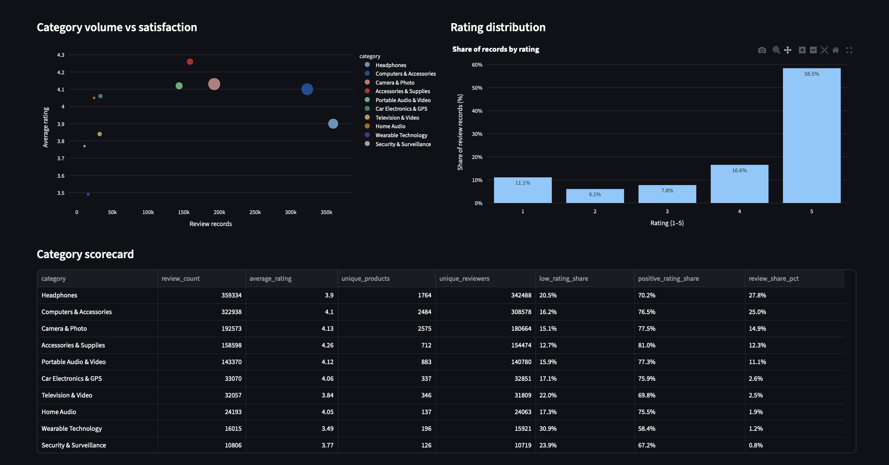

# Amazon Electronics Product & Review Analytics

An end-to-end data analytics project exploring historical Amazon electronics reviews using Python, SQL, Streamlit, and Power BI.

## Dashboard Preview





## Project Overview

This project analyses historical product-review data to understand customer rating patterns, product and category performance, and changes in review activity over time.

The workflow includes data cleaning, exploratory analysis, SQL queries, and an interactive dashboard.

## Tech Stack

- **Python:** Pandas, data cleaning, exploratory data analysis
- **SQL:** Analytical queries and aggregations
- **Streamlit:** Interactive analytics dashboard
- **Power BI:** Measures and dashboard development
- **Jupyter Notebook:** Exploratory analysis and documentation

## Key Questions

- How do customer ratings vary across product categories?
- How has review activity changed over time?
- Which products and brands receive the most reviews?
- What proportion of reviews receive low ratings?
- How do reviewer activity patterns vary?

## Repository Structure

```text
├── dashboard/    # Streamlit dashboard
├── docs/         # Data dictionary, findings and Power BI guide
├── notebooks/    # Exploratory analysis
├── power_bi/     # Power BI measures
├── sql/          # SQL analysis queries
├── src/          # Reproducible analysis pipeline
├── data/         # Local dataset (not tracked by Git)
├── outputs/      # Generated analysis outputs (not tracked by Git)
├── README.md
└── requirements.txt
```

## Getting Started

1. Clone this repository:

   ```bash
   git clone https://github.com/GurshaanSingh10/amazon-electronics-product-analytics.git
   cd amazon-electronics-product-analytics
   ```

2. Create and activate a virtual environment.

   ```bash
   python3 -m venv .venv
   source .venv/bin/activate
   ```

3. Install dependencies.

   ```bash
   pip install -r requirements.txt
   ```

4. Obtain the source dataset and place it at `data/electronics.csv`. Check the dataset's original source and license before downloading or redistributing it.

5. Run the analysis pipeline.

   ```bash
   python src/analysis_pipeline.py
   ```

6. Launch the dashboard.

   ```bash
   streamlit run dashboard/app.py
   ```

## Data & Limitations

The analysis uses historical product-review records. Review counts and ratings should not be interpreted as sales, revenue, conversion rates, or current customer sentiment.

The raw dataset and generated outputs are excluded from version control. Run the pipeline locally to generate the required outputs.

## Author

**Gurshaan Bajwa**

[GitHub Profile](https://github.com/GurshaanSingh10)
